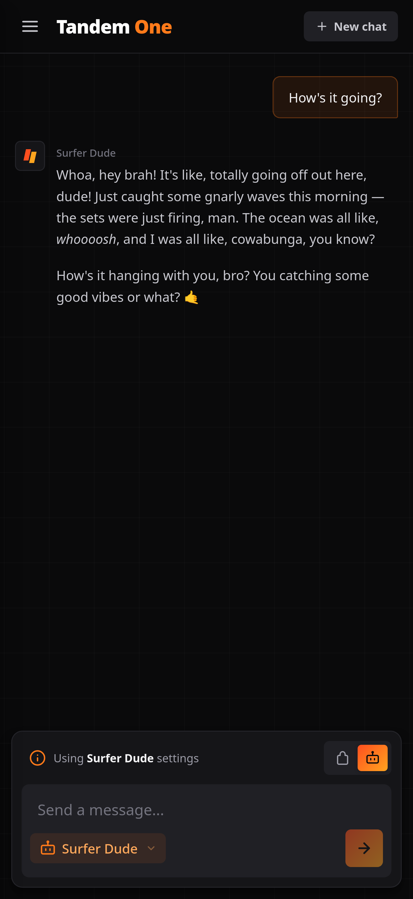
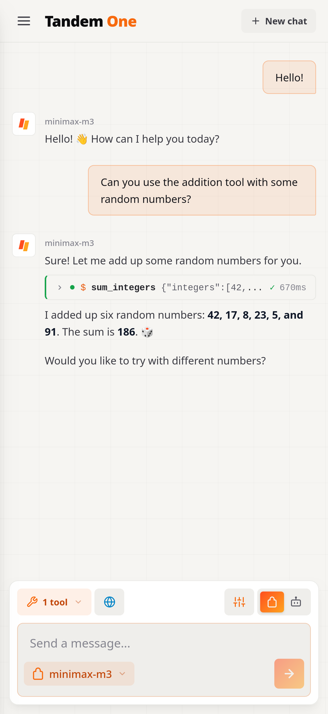
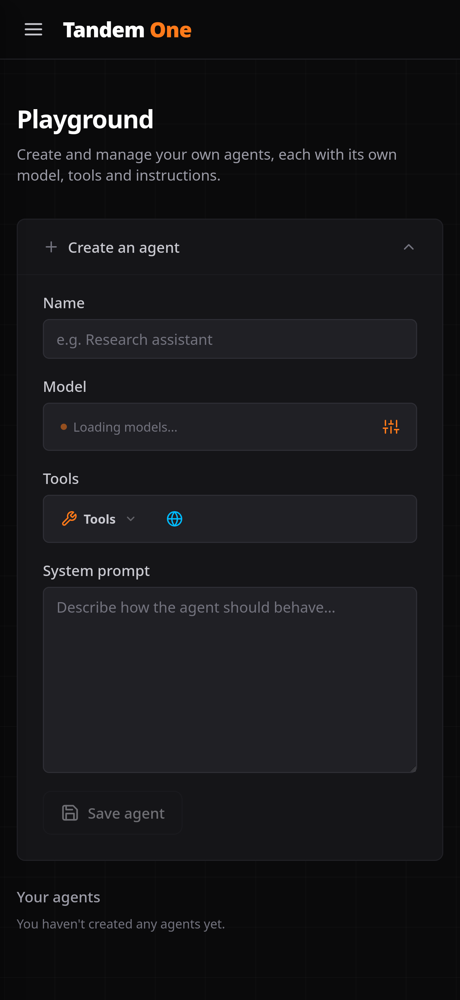

# Tandem One

A web-based AI chat frontend for [SynapseAPI](https://github.com/Toasted-ctrl/ai_api). Chat with models from multiple providers or with your own agents, give them tools (MCP servers, web search, your files, memories and skills), and manage it all from the browser.

## Features

- **Multi-provider chat** — stream responses from any configured provider and model, with adjustable sampling (temperature, top-p, top-k). Only the settings the selected model supports are offered.
- **Agents** — build your own agents in the Playground: a name, a system prompt, a model with sampling settings, and a set of tools. Agents can be viewed, edited and deleted later. In the chat, switch between talking to a model directly or to one of your agents; an agent always brings its own model and tools.
- **Tool use** — MCP tools, web search, and search over your own files, memories and skills. Tool calls and their results are shown inline in the conversation and can be expanded to see the details.
- **Web search** — opt-in per conversation; off by default and clearly highlighted when enabled.
- **My documents** — upload files (PDF, DOCX, TXT, MD, CSV) or save text memories to a personal vector store for retrieval.
- **Skills** — write reusable instructions for your models and agents. Skill descriptions are indexed so they can be discovered through vector search, and instructions can be edited in place.
- **Settings** — view your account details, manage provider API keys, and pick a light, dark, funky or system theme.
- **Google login** — authentication via Google OAuth.

<table>
  <tr>
    <th>Chat with an agent</th>
    <th>Chat with tools (light mode)</th>
    <th>Agent playground</th>
  </tr>
  <tr>
    <td></td>
    <td></td>
    <td></td>
  </tr>
</table>

## Tech stack

React 19, TypeScript, Tailwind CSS v4 (with the typography plugin), Vite, React Router. Markdown is rendered with `react-markdown` + `remark-gfm`; text is extracted from uploads client-side with `pdfjs-dist` and `mammoth`.

## Getting started

### Prerequisites

- Node.js 22+
- A running SynapseAPI backend and an API key for it

### Development

Create a `.env` file in the project root:

```sh
VITE_API_KEY=your-api-key
VITE_API_BASE_URL=http://localhost:8000
```

Then:

```sh
npm install
npm run dev
```

The dev server starts at `http://localhost:5173`.

### Scripts

| Command | What it does |
|---|---|
| `npm run dev` | Start the Vite dev server |
| `npm run build` | Type-check and build to `dist/` |
| `npm run preview` | Serve the production build locally |
| `npm run lint` | Run ESLint |

## Docker

The app ships as an nginx-based container. The build bakes placeholders into the bundle, and `entrypoint.sh` replaces them with the real values when the container starts, so one image works in every environment.

```sh
docker build -t aife .
docker run -p 8080:80 \
  -e VITE_API_KEY=your-api-key \
  -e VITE_API_BASE_URL=https://your-api-host.example.com \
  aife
```

### Releasing

`build.sh` bumps the version in `VERSION`, builds the image and pushes it to your registry:

```sh
REGISTRY=your-registry.example.com:5000 ./build.sh          # patch bump (default)
REGISTRY=your-registry.example.com:5000 ./build.sh minor    # or: major
```

## Environment variables

| Variable | Description |
|---|---|
| `VITE_API_KEY` | SynapseAPI key, sent with every backend request |
| `VITE_API_BASE_URL` | Base URL of the SynapseAPI backend (e.g. `https://your-api-host.example.com`) |

> **Note:** both values end up in the JavaScript served to the browser, so the API key is visible to anyone who can load the app. Treat it as an application identifier, not a secret; user access is controlled by the Google login session.

## Project structure

```
src/
├── components/      UI components (chat window and toolbar, selectors, agent and skill forms, dialogs)
├── features/auth/   Google OAuth login
├── pages/           Route pages (chat, login, my documents, playground, settings)
├── services/        API clients, one per endpoint (streaming chat, agents, skills, documents, providers, user)
└── theme.ts         Light / dark / funky / system theme handling
```
